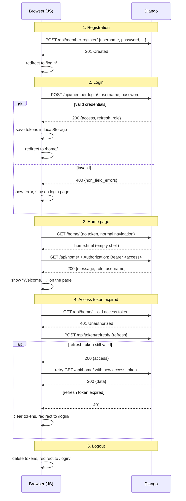

# Library — Registration and Login with JWT

A small Django project with registration and login for two kinds of users, **members** and **librarians**. Authentication uses **JWT** (JSON Web Tokens). The frontend is plain HTML, CSS, and JavaScript, and the JavaScript handles the access and refresh tokens so a logged-in user can reach a protected API.

## Contents

1. [Tech stack](#tech-stack)
2. [Setup](#setup)
3. [Project structure](#project-structure)
4. [Key idea: pages vs. APIs](#key-idea-pages-vs-apis)
5. [URL map](#url-map)
6. [Workflow](#workflow)
7. [Code walkthrough](#code-walkthrough)
8. [Testing the flow](#testing-the-flow)
9. [Troubleshooting](#troubleshooting)
10. [Security notes and next steps](#security-notes-and-next-steps)

---

## Tech stack

| Part | Technology |
|---|---|
| Backend | Django, Django REST Framework (DRF) |
| Auth | `djangorestframework-simplejwt` |
| Frontend | HTML, CSS, vanilla JavaScript (`fetch`) |
| Database | SQLite (Django default) |
| Token storage | Browser `localStorage` |

---

## Setup

```bash
# 1. Create and activate a virtual environment
python -m venv venv
source venv/bin/activate          # Windows: venv\Scripts\activate

# 2. Install dependencies
pip install django djangorestframework djangorestframework-simplejwt

# 3. Create the database tables
python manage.py makemigrations
python manage.py migrate

# 4. Run the server
python manage.py runserver
```

Then open <http://127.0.0.1:8000/login/>.

### Models

The code expects `Member` and `Librarian` models that each link to Django's built-in `User` through a field named `user`. For example:

```python
# library_app/models.py
from django.contrib.auth.models import User
from django.db import models


class Member(models.Model):
    user = models.OneToOneField(User, on_delete=models.CASCADE)

    def __str__(self):
        return self.user.username


class Librarian(models.Model):
    user = models.OneToOneField(User, on_delete=models.CASCADE)

    def __str__(self):
        return self.user.username
```

Username, password, and names are stored on `User`. `Member` and `Librarian` only record which role a user has.

---

## Project structure

```
library/                        # Django project package
├── settings.py                 # JWT and DRF configuration (see settings_changes.py)
└── urls.py                     # Includes library_app.urls at the root

library_app/                    # The app
├── models.py                   # Member, Librarian
├── serializers.py              # Validation for register and login
├── views.py                    # Page views + API views
├── urls.py                     # Page URLs and /api/ URLs
├── templates/
│   ├── login.html              # Member and librarian login forms
│   ├── memberRegister.html
│   ├── librarianRegister.html
│   └── home.html               # Empty shell, filled by home.js
└── static/
    ├── css/style.css           # Minimal styling
    └── js/
        ├── auth.js             # Shared token logic (loaded on every page)
        ├── login.js            # Login form handling
        ├── register.js         # Registration form handling
        └── home.js             # Calls the protected API
```

---

## Key idea: pages vs. APIs

This is the one concept that makes the whole project make sense.

With JWT, the server proves who you are by reading this header on each request:

```
Authorization: Bearer <access_token>
```

**Only JavaScript `fetch()` calls can add that header.** When the browser *navigates* to a page, by typing a URL, clicking a link, or `window.location = ...`, it sends no `Authorization` header at all.

So if the `/home/` page itself were protected with `IsAuthenticated`, visiting it would always return **401 Unauthorized**, even right after a successful login.

The project solves this by splitting every feature into two kinds of URL:

| | Page views | API views |
|---|---|---|
| URLs | `/login/`, `/home/`, `/register/...` | `/api/...` |
| Returns | HTML (`render(...)`) | JSON (`Response(...)`) |
| Protected? | No | `/api/home/` is (`IsAuthenticated`) |
| Called by | Browser navigation | JavaScript `fetch()` |
| Contains private data? | No, just an empty layout | Yes |

The page loads first. Its JavaScript then calls the protected API with the token and puts the data into the page. If the user isn't logged in, the JavaScript sends them to `/login/`.

Django never combines the HTML and the data. The browser does, through JavaScript.

---

## URL map

### Pages

| URL | View | Template |
|---|---|---|
| `/` and `/login/` | `login_page` | `login.html` |
| `/register/member/` | `member_register_page` | `memberRegister.html` |
| `/register/librarian/` | `librarian_register_page` | `librarianRegister.html` |
| `/home/` | `home_page` | `home.html` |

### API

| Method | URL | Auth needed | Body | Success response |
|---|---|---|---|---|
| POST | `/api/member-register/` | No | `username, password, first_name, last_name` | `201 {"message": ...}` |
| POST | `/api/librarian-register/` | No | same as above | `201 {"message": ...}` |
| POST | `/api/member-login/` | No | `username, password` | `200 {"access", "refresh", "role"}` |
| POST | `/api/librarian-login/` | No | `username, password` | `200 {"access", "refresh", "role"}` |
| POST | `/api/token/refresh/` | No | `refresh` | `200 {"access"}` |
| GET | `/api/home/` | **Yes** (Bearer token) | — | `200 {"username", "first_name", "role", "message"}` |

Errors come back as DRF error JSON, for example:

```json
{ "non_field_errors": ["Invalid username or password."] }
{ "username": ["This username is already taken."] }
```

---

## Workflow

### The two tokens

| Token | Lifetime (settings) | Used for |
|---|---|---|
| **Access token** | 15 minutes | Sent with every protected request |
| **Refresh token** | 1 day | Only to get a new access token when the old one expires |

The short access lifetime limits the damage if a token leaks. The refresh token means the user doesn't have to log in again every 15 minutes.

The server stores **neither** token. JWT is stateless: each token is signed with Django's `SECRET_KEY`, and the server checks the signature and expiry on every request.

### Full flow



### Step by step

**1. Registration**
1. The user opens `/register/member/` or `/register/librarian/`.
2. `register.js` stops the normal form submit, collects the fields, and POSTs them as JSON to the register API.
3. The serializer checks that the username is free and the password passes Django's password validators.
4. It creates a `User` and a `Member` or `Librarian` row in one database transaction.
5. On success the user is sent to `/login/`. On failure the errors are shown under the form.

**2. Login**
1. The user fills in the member or librarian form on `/login/`.
2. `login.js` POSTs the username and password to the matching login API. The form's `data-endpoint` attribute tells it which one.
3. The serializer calls Django's `authenticate()` and checks that the user has the right role.
4. If valid, the view creates a token pair with `RefreshToken.for_user(user)` and returns it.
5. `login.js` saves both tokens to `localStorage` and redirects to `/home/`.
6. If invalid, the error is shown and **the user stays on the login page**, because the page only changes when JS explicitly redirects.

**3. Opening the home page**
1. The browser requests `/home/`. Django renders `home.html` with no checks, since the page has no private data.
2. `home.js` runs. If there's no access token, it redirects to `/login/` straight away.
3. Otherwise it calls `authFetch("/api/home/")`, which adds the `Authorization: Bearer ...` header.
4. On the server, `JWTAuthentication` reads the header, verifies the token, and sets `request.user`. `IsAuthenticated` then allows the request.
5. The view returns the user's name and role as JSON, and `home.js` puts it into the page.

**4. When the access token expires**
1. After 15 minutes, `/api/home/` returns **401**.
2. `authFetch()` catches the 401 and calls `/api/token/refresh/` with the refresh token.
3. If that works, it saves the new access token and retries the original request once. The user notices nothing.
4. If the refresh token has also expired (after 1 day), `authFetch()` clears the tokens and sends the user to `/login/`.

**5. Logout**
1. The user clicks **Log out**.
2. `logout()` in `auth.js` deletes both tokens and redirects to `/login/`.
3. There's no server call, because the server doesn't store tokens. See the security notes for how to make the server reject old refresh tokens too.

---

## Code walkthrough

### `settings.py`

```python
REST_FRAMEWORK = {
    'DEFAULT_AUTHENTICATION_CLASSES': (
        'rest_framework_simplejwt.authentication.JWTAuthentication',
    ),
}
```

This tells DRF to identify users from the `Authorization: Bearer` header. Because `SessionAuthentication` is **not** listed, DRF doesn't require a CSRF token on POST requests, which is why the JS `fetch()` calls work without one.

```python
SIMPLE_JWT = {
    'ACCESS_TOKEN_LIFETIME': timedelta(minutes=15),
    'REFRESH_TOKEN_LIFETIME': timedelta(days=1),
    'AUTH_HEADER_TYPES': ('Bearer',),
}
```

This sets the token lifetimes and the header prefix (`Bearer`), which must match what `auth.js` sends.

### `serializers.py`

Serializers validate incoming JSON before the view does anything with it.

**`BaseRegisterSerializer`** holds the shared registration logic. `MemberRegisterSerializer` and `LibrarianRegisterSerializer` only set which profile model to create, and whether the user gets `is_staff`.

- `validate_username()` rejects usernames that already exist. DRF calls it automatically because of its name pattern, `validate_<field>`.
- `validate_password()` runs the `AUTH_PASSWORD_VALIDATORS` from settings: minimum length, not too common, not all numbers, and not too similar to the username.
- `create()` calls `User.objects.create_user()`, which hashes the password, then creates the profile row. `@transaction.atomic` makes sure both rows are saved or neither is.

**`BaseLoginSerializer`** holds the shared login logic.

- `validate()` calls `authenticate()`, which checks the password and that the account is active. It then checks that the user has the right role, such as a member trying the member form.
- It returns the same "Invalid username or password." message for every failure, so nobody can find out which usernames exist.
- On success it adds `user` to `validated_data`, so the view doesn't need to look the user up again.

### `views.py`

**Page views** (`login_page`, `member_register_page`, `librarian_register_page`, `home_page`) are plain Django functions that return `render(...)`. They are not protected, for the reason explained in [Key idea: pages vs. APIs](#key-idea-pages-vs-apis).

**API views** use DRF's `@api_view` decorator and return `Response(...)` (JSON).

- `member_login` and `librarian_login` validate with the login serializer, then return a token pair made by the `_tokens_for(user)` helper, plus the user's role.
- `member_register` and `librarian_register` validate and save with the register serializer.
- `home` has `@permission_classes([IsAuthenticated])`. DRF rejects requests without a valid access token with 401 *before* the function runs. Inside, `request.user` is the logged-in user, taken from the token.

### `urls.py`

The project's `urls.py` includes the app at the root (`''`). The app's `urls.py` puts pages at clean URLs and all JSON endpoints under `/api/`. The refresh endpoint is SimpleJWT's built-in `TokenRefreshView`, so no custom code is needed for it.

### `auth.js` — shared token logic

Loaded on every page **before** the page's own script.

| Function | What it does |
|---|---|
| `saveTokens(access, refresh)` | Stores both tokens in `localStorage` |
| `getAccessToken()` | Reads the access token |
| `clearTokens()` | Deletes both tokens |
| `logout()` | Clears tokens and goes to `/login/` |
| `refreshAccessToken()` | POSTs the refresh token to `/api/token/refresh/` and saves the new access token. Returns `true` or `false` |
| `authFetch(url, options)` | Use instead of `fetch()` for protected APIs. Adds the Bearer header, and on a 401 refreshes and retries once, or logs out |
| `getErrorMessage(data)` | Turns DRF error JSON into readable text |

`authFetch()` is the heart of the client-side flow. Any new protected API you add later can be called with it and gets token refresh for free:

```javascript
const response = await authFetch("/api/books/");
const books = await response.json();
```

### `login.js`

`setupLogin(formId, usernameId, passwordId)` wires up one login form. It is called once for the member form and once for the librarian form. On submit it:

1. Prevents the normal form submit, so the page doesn't reload.
2. POSTs the credentials to the URL in the form's `data-endpoint` attribute.
3. On success, saves the tokens and redirects to `/home/`.
4. On failure, shows the error under the form.

### `register.js`

Handles the `register-form` on both registration pages. It uses `new FormData(form)` to collect the fields, so the inputs' `name` attributes must match the serializer field names: `username`, `password`, `first_name`, `last_name`.

### `home.js`

Runs when `/home/` loads:

1. Hooks up the **Log out** button.
2. Redirects to `/login/` if there is no access token.
3. Calls `authFetch("/api/home/")`.
4. Fills `#welcome` and `#role` with the response, hides "Loading…", and shows the content.

### Templates

- Every template loads `auth.js` first, then its own script.
- `login.html` uses `` in `data-endpoint`, so the JS never hard-codes API paths for login.
- `home.html` contains no user data from Django. It's filled entirely by `home.js`.

---

## Testing the flow

### In the browser

1. Register a member at `/register/member/`.
2. Log in at `/login/`. You should land on `/home/` and see "Welcome, <name>!".
3. Open DevTools → **Application → Local Storage** to see `access_token` and `refresh_token`.
4. Open DevTools → **Network**, reload `/home/`, and click the `home/` request under `/api/`. You'll see the `Authorization: Bearer ...` header.
5. Click **Log out**. The tokens disappear and you're back on `/login/`. Visiting `/home/` now redirects to login.

### Watching the refresh happen

In `settings.py`, temporarily set:

```python
'ACCESS_TOKEN_LIFETIME': timedelta(minutes=1),
```

Log in, wait just over a minute, and reload `/home/` with the Network tab open. You should see:

```
GET  /api/home/            401
POST /api/token/refresh/   200
GET  /api/home/            200
```

Set the lifetime back afterwards.

### With curl

```bash
# Register
curl -X POST http://127.0.0.1:8000/api/member-register/ \
  -H "Content-Type: application/json" \
  -d '{"username":"john","password":"S3cure-pass!","first_name":"John","last_name":"Doe"}'

# Log in (copy the "access" and "refresh" values from the response)
curl -X POST http://127.0.0.1:8000/api/member-login/ \
  -H "Content-Type: application/json" \
  -d '{"username":"john","password":"S3cure-pass!"}'

# Protected API without a token -> 401
curl http://127.0.0.1:8000/api/home/

# Protected API with a token -> 200
curl http://127.0.0.1:8000/api/home/ -H "Authorization: Bearer <access>"

# Get a new access token
curl -X POST http://127.0.0.1:8000/api/token/refresh/ \
  -H "Content-Type: application/json" \
  -d '{"refresh":"<refresh>"}'
```

---

## Troubleshooting

| Symptom | Likely cause |
|---|---|
| `/home/` shows "Loading…" forever | `auth.js` isn't loaded, or is loaded after `home.js`. Check the browser console |
| `ReferenceError: saveTokens is not defined` | Same as above: `auth.js` must come before the page script |
| `/api/home/` always 401, even after login | Header missing or misspelled. It must be exactly `Authorization: Bearer <token>`, and `AUTH_HEADER_TYPES` must include `Bearer` |
| 403 CSRF error on login/register | `SessionAuthentication` was added to `DEFAULT_AUTHENTICATION_CLASSES`. Remove it, or send a CSRF token |
| Static files 404 | `STATIC_URL` missing from settings, or `DEBUG = False` without `collectstatic` |
| `NoReverseMatch` in a template | A `` doesn't match a `name=` in `urls.py` |
| `NameError: timedelta` on startup | Add `from datetime import timedelta` to the top of `settings.py` |
| Logged out after exactly 1 day | Expected: the refresh token expired. Raise `REFRESH_TOKEN_LIFETIME` or enable `ROTATE_REFRESH_TOKENS` |

---

## Security notes and next steps

- **localStorage and XSS.** Any script running on your site can read `localStorage`, so an XSS bug could leak tokens. This is acceptable for learning. Production apps often store the refresh token in an **HttpOnly cookie** instead, which JavaScript can't read.
- **Logout is client-side only.** A copied refresh token keeps working until it expires. To revoke it on logout, add `'rest_framework_simplejwt.token_blacklist'` to `INSTALLED_APPS`, run `migrate`, and create a logout API that blacklists the refresh token.
- **Anyone can register as a librarian.** Restrict `/api/librarian-register/` to existing librarians or admins in a real app.
- **Roles aren't enforced on APIs yet.** `/api/home/` accepts any logged-in user. For librarian-only endpoints, write a custom permission class such as `IsLibrarian` that checks `Librarian.objects.filter(user=request.user).exists()`.
- **Use HTTPS in production.** Tokens sent over plain HTTP can be intercepted.
- **Keep `SECRET_KEY` secret.** Tokens are signed with it; anyone who has it can create valid tokens.